# FaceLink — Front

Agregador de links no estilo Linktree: cada pessoa monta uma página pública com seus links, redes sociais, tema e foto,
acompanha visitas e cliques em tempo real e compartilha o endereço `/@usuario`.

Este repositório é o **front** (Next.js). A API fica em
[Agregador_Link_api](https://github.com/isaqu33/Agregador_Link_api).

| Painel (escuro) | Painel (claro) |
|---|---|
| 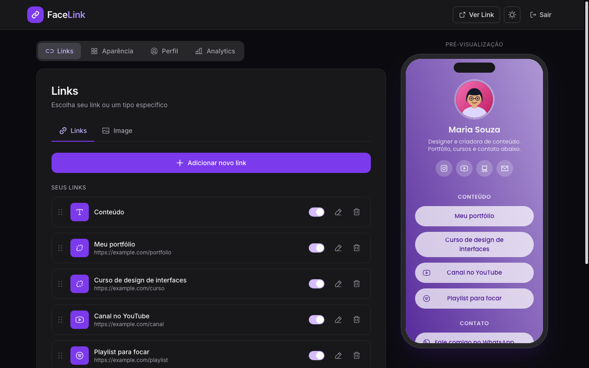 | 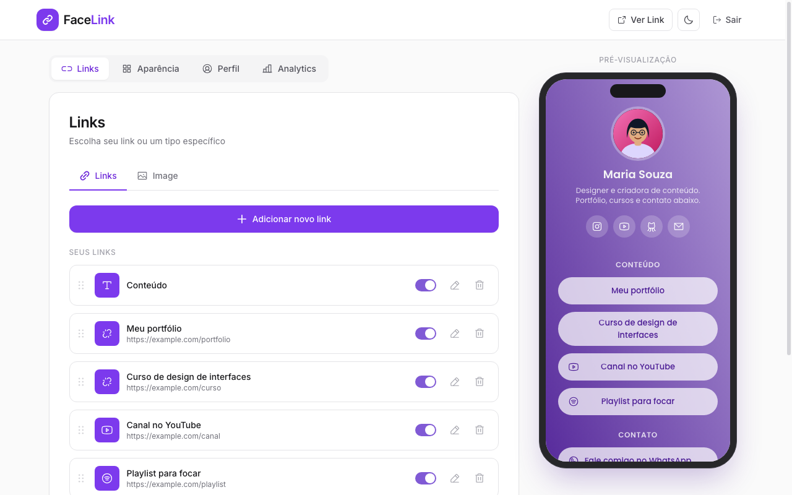 |

| Aparência | Perfil |
|---|---|
| 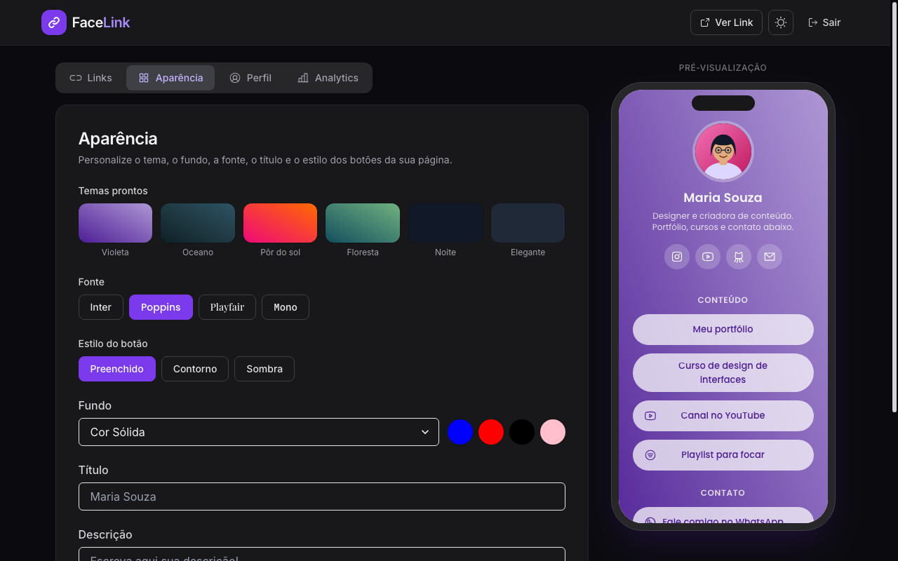 | 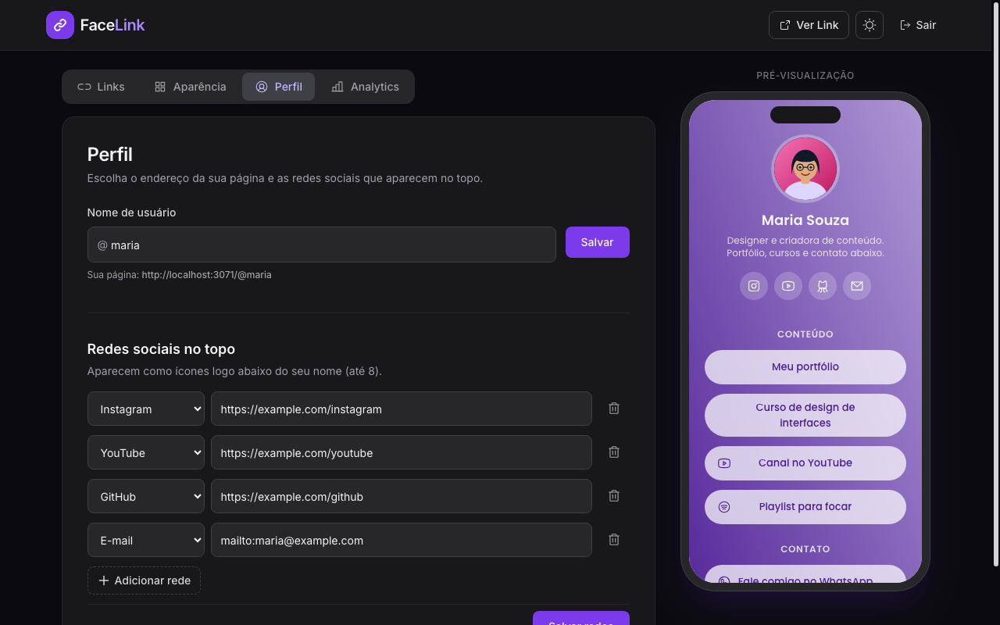 |

| Analytics ao vivo | Página pública (celular) |
|---|---|
| 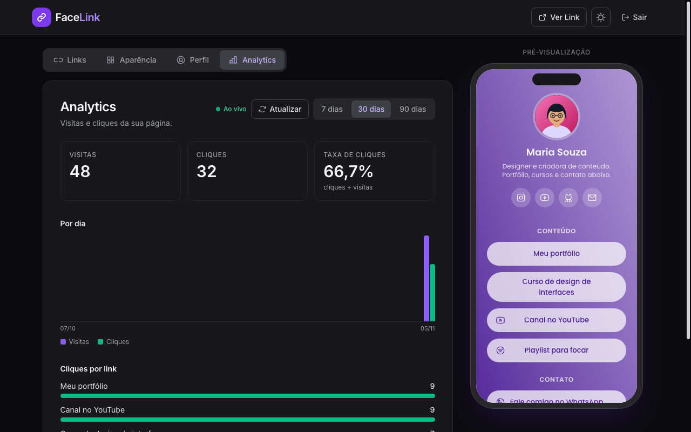 |  |

| Opções avançadas do link | Analytics completo |
|---|---|
| 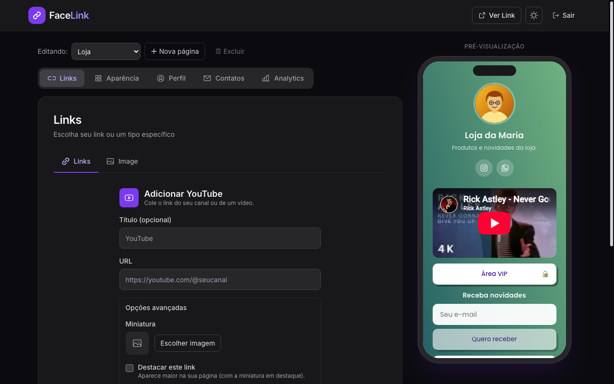 | 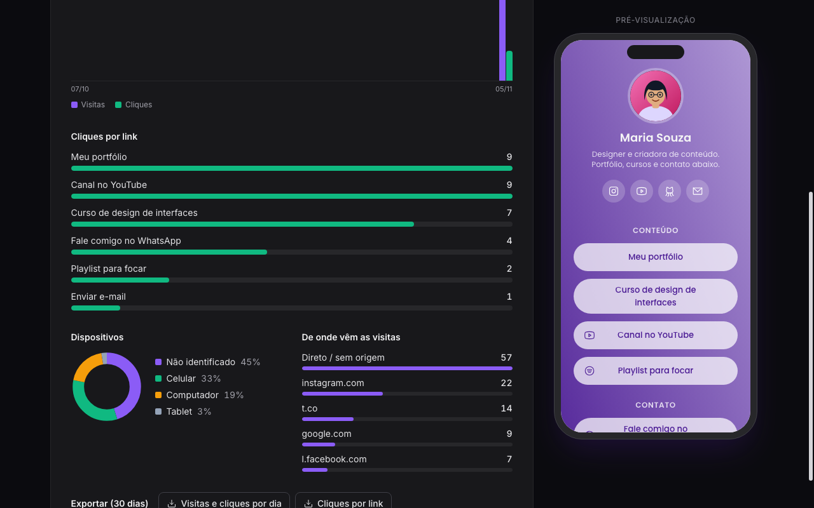 |

| Compartilhar, QR Code e pixels | Link com senha e gorjeta (Pix) |
|---|---|
| 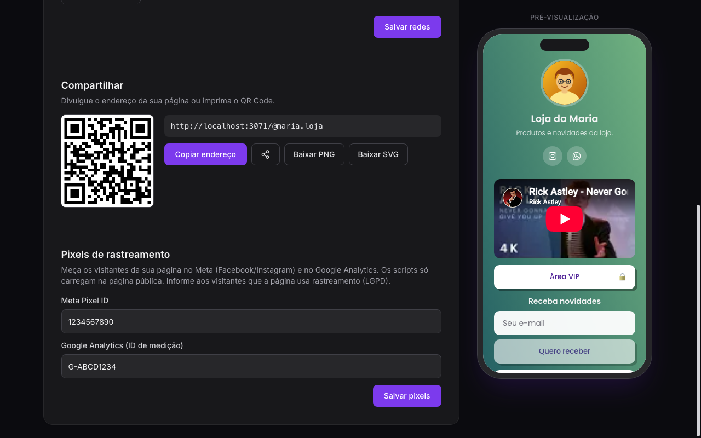 | 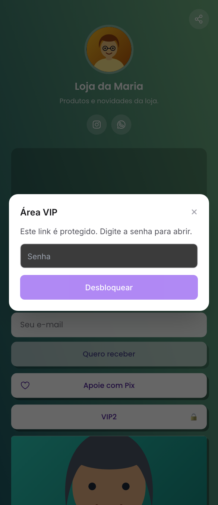 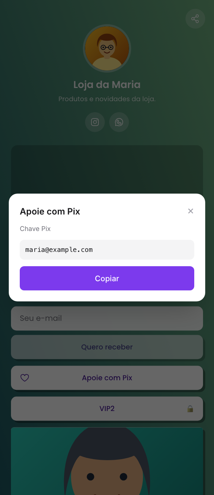 |

> As capturas usam uma conta fictícia ("Maria Souza") e avatares prontos do próprio projeto.

## O que o produto faz

**Página pública** (`/@usuario` ou `/:id`)
- Renderizada **no servidor** (SSR), com título, descrição, Open Graph, Twitter Card e URL canônica por perfil.
- Avatar, título, descrição, **ícones de redes sociais no topo**, cabeçalhos de seção e botões de link.
- 12 tipos de link: Link, Cabeçalho, **Captura de e-mail**, **Gorjeta (Pix)**, Instagram, TikTok, WhatsApp (número vira
  `wa.me`), Telefone (`tel:`), E-mail (`mailto:`), YouTube, Spotify e Twitch.
- **Miniatura**, **destaque** (maior, com banner), **agendamento** (aparece/some em datas), **player** do YouTube/Spotify
  na própria página e **senha por link** (o endereço real só chega depois de digitar a senha).
- Formulário de **captura de e-mail** (com armadilha anti-robô) e botão **Pix** (copiar chave; QR Code se for "copia e cola").
- Botão **compartilhar** (menu do celular ou copiar endereço) e **pixels** Meta/Google Analytics.
- **Várias páginas por conta:** cada página extra tem endereço, aparência, links, contatos e estatísticas próprios.
- Cada visita e cada clique são contados (dispositivo e origem da visita incluídos).

**Painel** (`/costumer`, exige login)
- **Links:** criar, editar, ativar/desativar, excluir e **reordenar arrastando**.
- **Aparência:** 6 temas prontos, fundo (cor sólida ou gradiente), 4 fontes, 3 estilos de botão (preenchido, contorno,
  sombra) e 3 formatos. A prévia no celular reage na hora; só salva em "Atualizar".
- **Perfil:** nome de usuário único (`/@usuario`), até 8 redes sociais, **QR Code** (baixa PNG/SVG), compartilhar e pixels.
- **Páginas:** seletor no topo para alternar entre a página principal e até 5 páginas extras (criar/excluir).
- **Contatos:** e-mails coletados pelos formulários, com remoção e **exportação CSV**.
- **Foto:** upload com recorte quadrado (guia circular) ou galeria de 12 avatares prontos.
- **Analytics:** visitas, cliques, taxa de cliques, gráfico por dia, cliques por link, **dispositivos** e **origens** das
  visitas (7, 30 ou 90 dias), **atualizado ao vivo** por SSE, botão "Atualizar" e **exportação CSV**.
- Tema claro/escuro, aviso de e-mail não confirmado e carregamento com spinner/esqueleto.

**Conta**
- Cadastro e login por e-mail e senha, **recuperação de senha** e **confirmação de e-mail** por link de uso único.
- **Login com Google** (opcional; liga com `AUTH_GOOGLE_*` no `.env`).

## Arquitetura

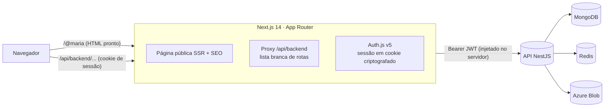

Decisões que valem destacar:

- **O navegador nunca vê o token da API.** O JWT fica dentro do cookie de sessão criptografado do Auth.js. Toda
  chamada passa por `/api/backend/...`, um proxy que lê o cookie, injeta `Authorization` e só encaminha rotas de uma
  **lista branca** (públicas e privadas). O login nem passa por ele: vai direto do servidor do Next para a API.
- **Uma só renderização para prévia e página pública.** O componente `ProfileView` desenha a página nos dois lugares,
  então o que o usuário vê no celular do painel é exatamente o que os visitantes verão.
- **SSR só onde importa.** A página pública é servida como HTML completo (SEO, compartilhamento em redes). As telas
  do painel renderizam só no navegador (componente `ClientOnly`), porque usam `window`. Evitei `next/dynamic` com `loading`:
  o React segura a troca de um fallback por ~300 ms, e medi que isso era todo o atraso ao trocar de aba (caiu de ~350 ms para ~50 ms).
- **Tempo real sem polling.** A aba Analytics abre um `EventSource` (SSE); a cada visita/clique a API avisa e a tela
  busca os números de novo. Ao reconectar depois de uma queda (repouso, rede), ela se atualiza sozinha.
- **Estado em um lugar só.** Dados do servidor ficam no react-query (`useMe`); o rascunho de Aparência fica em MobX;
  a sessão no cookie. Nada de dados do usuário no `localStorage` (só a preferência de tema).
- **IP do visitante preservado.** O proxy e o login repassam `x-forwarded-for` para a API aplicar rate limit por IP.

## Stack

Next.js 14 (App Router) · React 18 · TypeScript · Auth.js v5 · Chakra UI 2 · Tailwind 3 · react-query 3 · MobX ·
`@dnd-kit` (arrastar e soltar) · `react-image-crop` · `next/font` (Inter, Poppins, Playfair Display, Roboto Mono).

## Rodando (desenvolvimento)

Requisitos: Docker e Docker Compose. **A API precisa estar no ar antes**: ela cria a rede `agregador-network`.

```bash
# 1) API (repositório Agregador_Link_api): MongoDB, Redis, Azurite e a API
cd ../Agregador_Link_api
cp .env.example .env            # defina SECRET_JWT e SEED_USER_*
docker compose -f docker-compose.dev.yml up -d --build -V
docker compose -f docker-compose.dev.yml exec api npm run seed   # cria o primeiro usuário

# 2) Front
cd ../Agregador_Link_Front
cp .env.example .env            # defina AUTH_SECRET (openssl rand -hex 32); Google é opcional
docker compose -f docker-compose.dev.yml up -d --build -V
```

Abra http://localhost:3071/login (front) — a API responde em http://localhost:3070.

Sem SMTP configurado, os e-mails de confirmação e de recuperação de senha **aparecem no log da API**
(`docker logs agregador-api-dev`), com o link pronto para copiar.

## Rotas

| Rota | Descrição |
|---|---|
| `/login` | entrar / cadastrar / "esqueci minha senha" |
| `/forgot-password`, `/reset-password?token=` | recuperação de senha |
| `/verify-email?token=` | confirmação de e-mail |
| `/costumer` | links |
| `/costumer/appearance` | aparência |
| `/costumer/profile` | nome de usuário e redes sociais |
| `/costumer/leads` | contatos coletados |
| `/costumer/analytics` | visitas, cliques, dispositivos e origens |
| `/@usuario` · `/:id` | página pública (SSR) |

`/@usuario` é uma reescrita (`next.config.mjs`) para `app/u/[username]`.

## Estrutura

```
app/                      rotas do App Router
  [id]/, u/[username]/    página pública (SSR + generateMetadata)
  api/backend/[...path]/  proxy autenticado para a API (lista branca)
  api/auth/               Auth.js
  costumer/               painel (layout server exige sessão)
  login/ forgot-password/ reset-password/ verify-email/
auth.ts                   configuração do Auth.js (Credentials)
src/
  Shell.tsx               casca do painel (navegação, prévia no celular)
  views/                  telas do painel e de autenticação
  componentes/            ProfileView (página), formulários, modais, Loader…
  lib/perfilPublico.ts    busca do perfil no servidor (SSR)
  perfilEstilo.ts         fontes, temas, estilos de botão, leitura do template
  utils/objectstoberendered.tsx   registro dos tipos de link e das redes
  server/api.tsx          hook useApi (axios -> /api/backend)
  hooks/useMe.ts          fonte única do usuário logado
public/assets/            imagens estáticas e 12 avatares prontos
screenshots/              capturas usadas neste README
```

## Verificação

```bash
npx tsc --noEmit    # tipos
npx next build      # build de produção
```

O front ainda não tem testes automatizados; a lógica testada (auth, links, analytics, segurança HTTP) está na API.

## Segurança

- Token da API nunca no navegador; cookie de sessão criptografado, expira em 24 h.
- O destino de um link com senha não vai no HTML nem no JSON da página pública; só a API o devolve após a senha.
- Pixels: só IDs no formato esperado entram na página (nada digitado vira código); players só de `youtube-nocookie.com` e `open.spotify.com`, em `iframe` com `sandbox`.
- Proxy com lista branca: rota nova da API usada pelo front precisa ser liberada em `app/api/backend/[...path]/route.ts`.
- Rotas privadas validam a sessão no servidor antes de repassar; o `/costumer` redireciona para `/login` sem sessão.
- Links só `http(s)`, `mailto:` e `tel:` (validados na API); o front acrescenta `rel="noopener noreferrer"`.
- `.env` não é versionado.

## Roadmap

Feito: editar e reordenar links, 12 tipos de link, redes no topo, `/@usuario`, SSR + SEO, analytics (com tempo real,
dispositivos, origens e CSV), temas/fontes/botões, recuperar senha e confirmar e-mail, miniaturas, destaque,
agendamento, player, QR Code, compartilhar, coleta de e-mail, login com Google, pixels, exportação, gorjeta (Pix),
senha por link e várias páginas.

Pendências: país nas analytics (exige base de GeoIP), banner de consentimento para os pixels, testes automatizados do
front e teste do login com Google com credenciais reais.
